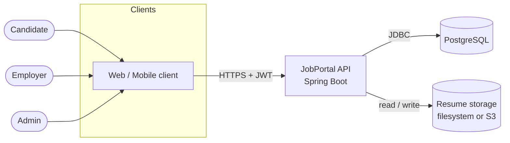
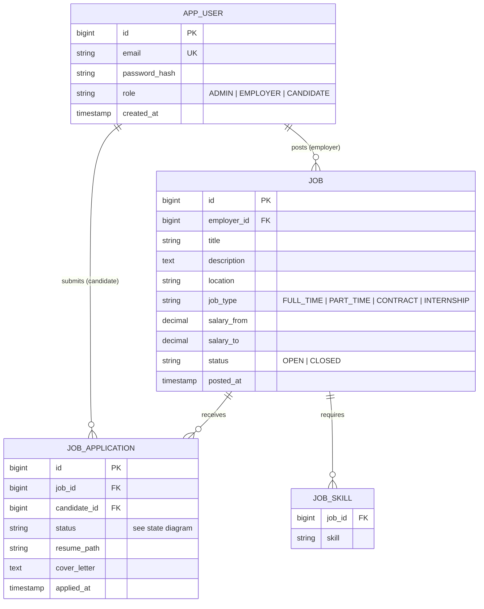
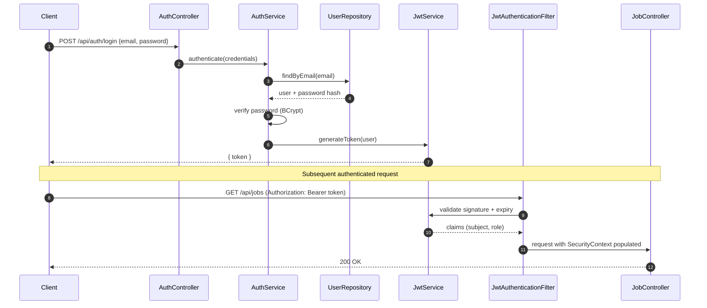
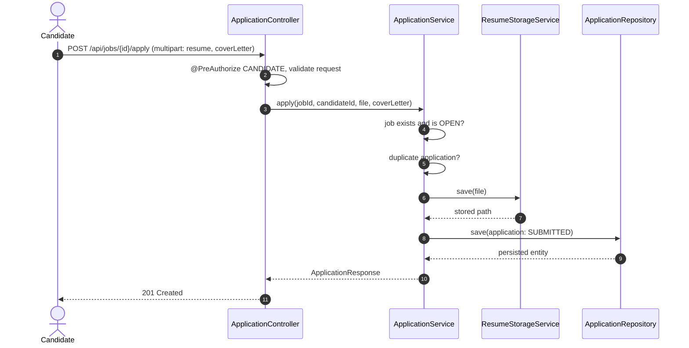
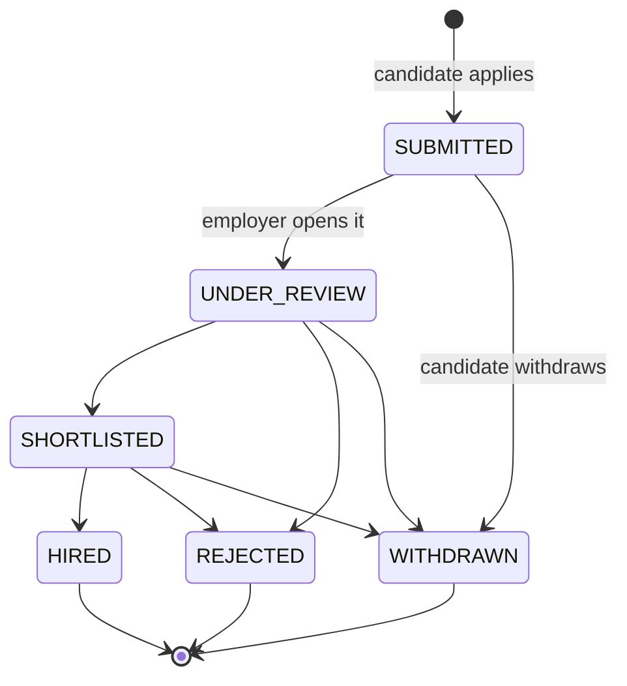
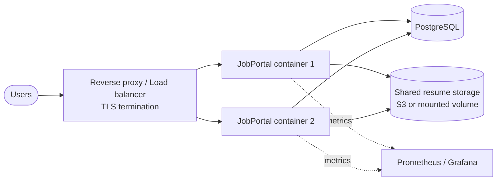
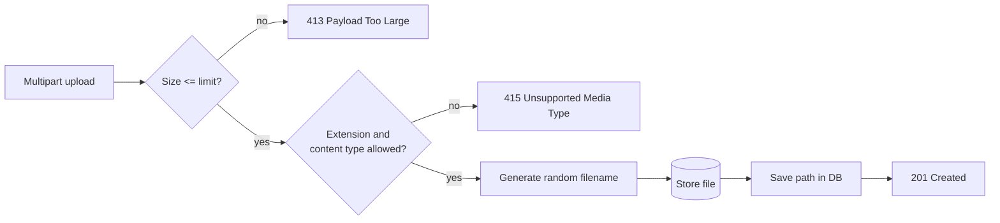
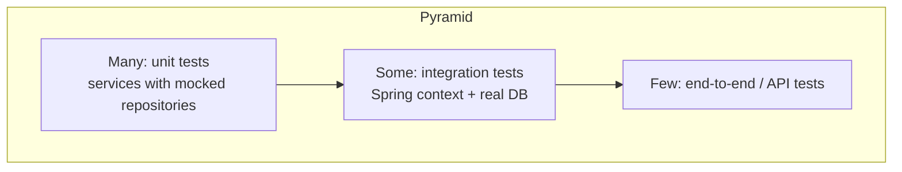
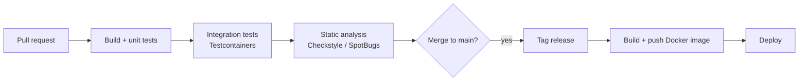

# JobPortal — Spring Boot Backend

A layered, extensible Job Portal REST API built with Spring Boot. It covers user registration, JWT authentication, role-based authorization, job posting and search, and a candidate application flow with resume upload.

It is both a working service and a reference for building production-style REST APIs: layered architecture, DTOs, validation, security, migrations, containerization, CI and tests.

> **How to read this document:** every major section explains *what* to do and *why* the project does it that way. Commands are copy-paste ready. Items marked **(verify)** depend on your actual code and should be checked against the source before you publish this README.

---

## Table of contents

1. [Project summary](#1-project-summary)
2. [Key features](#2-key-features)
3. [Architecture](#3-architecture)
4. [Design decisions and rationale](#4-design-decisions-and-rationale)
5. [Tech stack](#5-tech-stack)
6. [Prerequisites](#6-prerequisites)
7. [Quick start](#7-quick-start)
8. [Configuration](#8-configuration)
9. [Database and migrations](#9-database-and-migrations)
10. [Docker and deployment](#10-docker-and-deployment)
11. [API reference](#11-api-reference)
12. [Security](#12-security)
13. [File uploads](#13-file-uploads)
14. [Pagination, filtering and sorting](#14-pagination-filtering-and-sorting)
15. [Error handling](#15-error-handling)
16. [Testing](#16-testing)
17. [Logging, metrics and monitoring](#17-logging-metrics-and-monitoring)
18. [CI/CD](#18-cicd)
19. [Development and contribution guide](#19-development-and-contribution-guide)
20. [Troubleshooting](#20-troubleshooting)
21. [Roadmap](#21-roadmap)
22. [License and contact](#22-license-and-contact)

---

## 1. Project summary

This service provides REST endpoints for:

- User registration, authentication and role management (`ADMIN`, `EMPLOYER`, `CANDIDATE`)
- Job posting CRUD with search and filtering
- Job application flow: apply with a resume, track status
- Employer and candidate views of applications
- Validation, pagination and role-based authorization

**Who uses it**

| Actor | Can do |
|-------|--------|
| Candidate | Browse jobs, apply with a resume, view own applications, withdraw |
| Employer | Post and manage own jobs, review applications for own jobs, update application status |
| Admin | Everything an employer can do on any job, plus user management |

---

## 2. Key features

- Role-based access control (RBAC) enforced at the method level
- Job search by title, skills, location, job type and salary range
- Candidate apply workflow with server-side validated resume upload
- DTO-based API contracts, so entities are never exposed directly
- Spring Data JPA repositories with a transactional service layer
- Bean Validation on every request body
- Unit and integration tests (H2 or Testcontainers)
- Environment-specific behaviour through Spring profiles
- Flyway-managed schema (recommended; see [section 9](#9-database-and-migrations))

---

## 3. Architecture

### 3.1 System context

Who talks to the system and what it depends on.



### 3.2 Layered architecture

Each layer only calls the layer directly beneath it. This keeps HTTP concerns, business rules and persistence independently testable.

```mermaid
flowchart TB
    Req[Incoming HTTP request] --> SF

    subgraph Security
        SF[JwtAuthenticationFilter<br/>validates token, sets SecurityContext]
    end

    SF --> C

    subgraph Web layer
        C[Controllers<br/>routing, validation, DTO mapping]
        EH[GlobalExceptionHandler<br/>@RestControllerAdvice]
    end

    C --> S

    subgraph Business layer
        S[Services<br/>business rules, transactions, authorization checks]
        FS[ResumeStorageService]
    end

    S --> R
    S --> FS

    subgraph Persistence layer
        R[Repositories<br/>Spring Data JPA]
    end

    R --> DB[(PostgreSQL)]
    FS --> Disk[(Filesystem / S3)]
    C -. exceptions .-> EH
```

### 3.3 Package layout **(verify)**

```
src/main/java/com/yourorg/jobportal
├── config/        # Beans, CORS, OpenAPI, storage properties
├── controller/    # REST controllers (thin: parse, validate, delegate)
├── dto/           # Request/response DTOs and mappers
├── exception/     # Custom exceptions and the global handler
├── model/         # JPA entities and enums
├── repository/    # Spring Data JPA interfaces
├── security/      # JWT filter, token service, UserDetailsService, config
└── service/       # Business logic and transactions

src/main/resources
├── application.yml
├── application-dev.yml
├── application-prod.yml
└── db/migration/  # Flyway scripts (V1__init.sql, ...)
```

### 3.4 Data model



### 3.5 Authentication flow



### 3.5 Apply-for-a-job flow



### 3.6 Application status lifecycle **(verify against your enum)**



Why model this explicitly: invalid transitions (for example `REJECTED` back to `SHORTLISTED`) are a business-rule violation. Enforcing them in the service layer keeps the rules in one place instead of scattered across controllers.

### 3.7 Deployment topology



---

## 4. Design decisions and rationale

| Decision | Why | Trade-off |
|----------|-----|-----------|
| **Layered architecture** (controller → service → repository) | Separates HTTP, business rules and persistence so each can change and be tested alone. | More files and mapping code than a flat design. |
| **DTOs instead of returning entities** | Prevents leaking internal fields (such as password hashes), avoids lazy-loading errors during serialization, and lets the API evolve without changing the schema. | Needs mappers (hand-written or MapStruct). |
| **Stateless JWT authentication** | No server-side session store, which makes horizontal scaling straightforward. | Tokens cannot be revoked before expiry without extra work (blocklist or short expiry plus refresh tokens). |
| **Method-level security** (`@PreAuthorize`) | Authorization sits next to the business operation it protects and is hard to forget. | Requires `@EnableMethodSecurity`; rules are spread across classes. |
| **Transactions at the service layer** | A use case (for example "apply") is one atomic unit even if it touches several repositories. | Services must not be called from inside long-running external I/O. |
| **PostgreSQL in production, H2 in dev/test** | H2 gives fast feedback; Postgres matches production behaviour. | H2 can mask dialect differences, so run integration tests against Testcontainers Postgres before releasing. |
| **Flyway for schema changes** | Schema is versioned, reviewable and reproducible in every environment. `ddl-auto=update` can silently drift or destroy data. | Every schema change needs a migration script. |
| **Externalised configuration** (env vars + profiles) | Same artifact runs in every environment; secrets stay out of the repository. | Misconfiguration surfaces at startup, so validate required properties early. |
| **Resume files outside the database** | Large binaries bloat the DB and slow backups. | Two stores must stay consistent; clean up orphaned files. |
| **Server-side upload validation** | Client checks are trivially bypassed. | Slightly more code in the storage service. |

---

## 5. Tech stack

- Java 17+ (see `pom.xml` for the exact release)
- Spring Boot: Web, Data JPA, Security, Validation, Actuator
- PostgreSQL 16 (production), H2 (dev/tests)
- Flyway (migrations)
- Maven via the bundled wrapper `./mvnw`
- springdoc-openapi for Swagger UI (optional)
- JUnit 5, Mockito, Spring Security Test, Testcontainers

> Check `pom.xml` for exact versions rather than relying on this list.

---

## 6. Prerequisites

- Java 17 or newer (`java -version`)
- Docker and Docker Compose (optional, for the containerised setup)
- PostgreSQL 14+ (optional; H2 works out of the box for local runs)

You do not need to install Maven; use `./mvnw`.

---

## 7. Quick start

### Option A: run locally with H2 (fastest)

```bash
git clone <repo-url>
cd jobportal

# Build and run the tests
./mvnw clean verify

# Start the app with the dev profile
export SPRING_PROFILES_ACTIVE=dev
export APP_JWT_SECRET="change-me-to-a-long-random-string-of-at-least-32-chars"
./mvnw spring-boot:run
```

The API is now available at `http://localhost:8080`.

### Option B: run everything with Docker Compose

```bash
docker compose up --build
```

See [section 10](#10-docker-and-deployment) for the compose file.

### Smoke test

```bash
# Register a candidate
curl -s -X POST http://localhost:8080/api/auth/register \
  -H "Content-Type: application/json" \
  -d '{"email":"candidate@example.com","password":"Str0ngPass!","role":"CANDIDATE"}'

# Log in and capture the token
TOKEN=$(curl -s -X POST http://localhost:8080/api/auth/login \
  -H "Content-Type: application/json" \
  -d '{"email":"candidate@example.com","password":"Str0ngPass!"}' | jq -r .token)

# List jobs
curl -s -H "Authorization: Bearer $TOKEN" "http://localhost:8080/api/jobs?page=0&size=10"
```

Swagger UI (if enabled): `http://localhost:8080/swagger-ui/index.html`

---

## 8. Configuration

Configuration is read from `application.yml` and profile-specific files, and can be overridden by environment variables. Spring maps `SPRING_DATASOURCE_URL` to `spring.datasource.url` automatically.

### 8.1 Environment variables

| Variable | Required | Example | Purpose |
|----------|----------|---------|---------|
| `SPRING_PROFILES_ACTIVE` | No | `dev`, `test`, `prod` | Selects the profile |
| `SPRING_DATASOURCE_URL` | Prod | `jdbc:postgresql://localhost:5432/jobportal` | Database URL |
| `SPRING_DATASOURCE_USERNAME` | Prod | `jobportal` | Database user |
| `SPRING_DATASOURCE_PASSWORD` | Prod | `secret` | Database password |
| `SPRING_JPA_HIBERNATE_DDL_AUTO` | No | `validate` | Hibernate schema mode |
| `APP_JWT_SECRET` | Yes | 32+ random chars | Signing key for tokens |
| `APP_JWT_EXP_MS` | No | `3600000` | Token lifetime in ms |
| `APP_UPLOAD_RESUME_DIR` | No | `/var/data/resumes` | Resume storage directory |

### 8.2 Reference `application.yml`

```yaml
spring:
  application:
    name: jobportal
  datasource:
    url: ${SPRING_DATASOURCE_URL:jdbc:h2:mem:jobportal;DB_CLOSE_DELAY=-1}
    username: ${SPRING_DATASOURCE_USERNAME:sa}
    password: ${SPRING_DATASOURCE_PASSWORD:}
  jpa:
    hibernate:
      ddl-auto: ${SPRING_JPA_HIBERNATE_DDL_AUTO:validate}
    open-in-view: false
  servlet:
    multipart:
      max-file-size: 5MB
      max-request-size: 6MB

app:
  jwt:
    secret: ${APP_JWT_SECRET}
    expiration-ms: ${APP_JWT_EXP_MS:3600000}
  upload:
    resume-dir: ${APP_UPLOAD_RESUME_DIR:./uploads/resumes}

management:
  endpoints:
    web:
      exposure:
        include: health,info,metrics

logging:
  level:
    root: INFO
    com.yourorg.jobportal: INFO
```

Why these defaults:

- `open-in-view: false` stops lazy loading from leaking into the web layer, which would hide N+1 queries.
- `ddl-auto: validate` makes Hibernate check the schema against the entities without changing it; Flyway owns schema changes.
- `APP_JWT_SECRET` has no default on purpose: the app should refuse to start without a real secret.
- Multipart limits are set explicitly so oversized uploads are rejected early.

### 8.3 Profile overrides

`application-dev.yml`

```yaml
spring:
  h2:
    console:
      enabled: true
  jpa:
    show-sql: true
logging:
  level:
    com.yourorg.jobportal: DEBUG
```

`application-prod.yml`

```yaml
spring:
  jpa:
    show-sql: false
  h2:
    console:
      enabled: false
management:
  endpoint:
    health:
      show-details: when-authorized
```

---

## 9. Database and migrations

- Development: H2 in memory, which is fast but not identical to Postgres.
- Production: PostgreSQL with Flyway migrations in `src/main/resources/db/migration`.
- Flyway runs automatically at startup. Never edit a migration that has already been applied; add a new one.

Example `V1__init.sql`:

```sql
CREATE TABLE app_user (
    id            BIGSERIAL PRIMARY KEY,
    email         VARCHAR(255) NOT NULL UNIQUE,
    password_hash VARCHAR(100) NOT NULL,
    role          VARCHAR(20)  NOT NULL,
    created_at    TIMESTAMP    NOT NULL DEFAULT now()
);

CREATE TABLE job (
    id          BIGSERIAL PRIMARY KEY,
    employer_id BIGINT       NOT NULL REFERENCES app_user (id),
    title       VARCHAR(200) NOT NULL,
    description TEXT         NOT NULL,
    location    VARCHAR(200),
    job_type    VARCHAR(20)  NOT NULL,
    salary_from NUMERIC(12, 2),
    salary_to   NUMERIC(12, 2),
    status      VARCHAR(20)  NOT NULL DEFAULT 'OPEN',
    posted_at   TIMESTAMP    NOT NULL DEFAULT now()
);

CREATE TABLE job_skill (
    job_id BIGINT       NOT NULL REFERENCES job (id) ON DELETE CASCADE,
    skill  VARCHAR(100) NOT NULL,
    PRIMARY KEY (job_id, skill)
);

CREATE TABLE job_application (
    id           BIGSERIAL PRIMARY KEY,
    job_id       BIGINT      NOT NULL REFERENCES job (id),
    candidate_id BIGINT      NOT NULL REFERENCES app_user (id),
    status       VARCHAR(20) NOT NULL DEFAULT 'SUBMITTED',
    resume_path  VARCHAR(500) NOT NULL,
    cover_letter TEXT,
    applied_at   TIMESTAMP   NOT NULL DEFAULT now(),
    CONSTRAINT uq_application_job_candidate UNIQUE (job_id, candidate_id)
);

CREATE INDEX idx_job_location   ON job (location);
CREATE INDEX idx_job_type       ON job (job_type);
CREATE INDEX idx_job_posted_at  ON job (posted_at DESC);
CREATE INDEX idx_app_candidate  ON job_application (candidate_id);
```

Why the unique constraint on `(job_id, candidate_id)`: the database, not just the service, guarantees a candidate cannot apply twice, even under concurrent requests.

---

## 10. Docker and deployment

### 10.1 Dockerfile (multi-stage)

```dockerfile
# ---- Build stage ----
FROM eclipse-temurin:17-jdk AS build
WORKDIR /workspace
COPY .mvn/ .mvn/
COPY mvnw pom.xml ./
RUN ./mvnw -q dependency:go-offline
COPY src ./src
RUN ./mvnw -q clean package -DskipTests

# ---- Runtime stage ----
FROM eclipse-temurin:17-jre
RUN useradd --system --uid 1001 appuser \
    && mkdir -p /app/uploads && chown appuser /app/uploads
WORKDIR /app
COPY --from=build /workspace/target/*.jar app.jar
USER appuser
EXPOSE 8080
ENTRYPOINT ["java", "-jar", "app.jar"]
```

Why multi-stage: the final image contains only the JRE and the jar (no Maven, no source), so it is smaller and has a smaller attack surface. Running as a non-root user limits damage if the app is compromised. Copying `pom.xml` before `src` lets Docker cache dependencies between builds.

### 10.2 docker-compose.yml

```yaml
services:
  db:
    image: postgres:16
    environment:
      POSTGRES_DB: jobportal
      POSTGRES_USER: jobportal
      POSTGRES_PASSWORD: jobportal
    volumes:
      - pgdata:/var/lib/postgresql/data
    healthcheck:
      test: ["CMD-SHELL", "pg_isready -U jobportal -d jobportal"]
      interval: 5s
      timeout: 3s
      retries: 10

  app:
    build: .
    depends_on:
      db:
        condition: service_healthy
    environment:
      SPRING_PROFILES_ACTIVE: prod
      SPRING_DATASOURCE_URL: jdbc:postgresql://db:5432/jobportal
      SPRING_DATASOURCE_USERNAME: jobportal
      SPRING_DATASOURCE_PASSWORD: jobportal
      APP_JWT_SECRET: ${APP_JWT_SECRET:?set APP_JWT_SECRET in your shell or .env file}
      APP_UPLOAD_RESUME_DIR: /app/uploads
    volumes:
      - resumes:/app/uploads
    ports:
      - "8080:8080"

volumes:
  pgdata:
  resumes:
```

Why the health check: `depends_on` alone only waits for the container to *start*, not for Postgres to accept connections, which causes flaky startup failures.

Run it:

```bash
export APP_JWT_SECRET="$(openssl rand -base64 48)"
docker compose up --build
```

> The compose passwords are for local use only. In real deployments inject credentials from a secrets manager.

### 10.3 Production notes

- Terminate TLS at a reverse proxy or load balancer.
- With more than one app instance, use shared storage (S3 or a shared volume) for resumes; local disk is per container.
- Run the database as a managed service with automated backups.

---

## 11. API reference

> Verify routes and DTO shapes against `src/main/java/**/controller`. With Swagger UI enabled, it is the source of truth.

### 11.1 Endpoint summary

| Method | Path | Role | Description |
|--------|------|------|-------------|
| POST | `/api/auth/register` | Public | Create an account |
| POST | `/api/auth/login` | Public | Obtain a JWT |
| GET | `/api/jobs` | Authenticated (or public) | Search and list jobs |
| GET | `/api/jobs/{id}` | Authenticated (or public) | Job details |
| POST | `/api/jobs` | EMPLOYER | Create a job |
| PUT | `/api/jobs/{id}` | Owner EMPLOYER, ADMIN | Update a job |
| DELETE | `/api/jobs/{id}` | Owner EMPLOYER, ADMIN | Delete a job |
| POST | `/api/jobs/{id}/apply` | CANDIDATE | Apply with a resume |
| GET | `/api/applications` | EMPLOYER, CANDIDATE | Role-scoped application list |
| PATCH | `/api/applications/{id}/status` | Owner EMPLOYER, ADMIN | Change application status **(verify)** |

### 11.2 Authentication

Register:

```bash
curl -s -X POST http://localhost:8080/api/auth/register \
  -H "Content-Type: application/json" \
  -d '{"email":"employer@example.com","password":"Str0ngPass!","role":"EMPLOYER"}'
```

Response `201 Created`:

```json
{ "id": 1, "email": "employer@example.com", "role": "EMPLOYER" }
```

Login:

```bash
curl -s -X POST http://localhost:8080/api/auth/login \
  -H "Content-Type: application/json" \
  -d '{"email":"employer@example.com","password":"Str0ngPass!"}'
```

Response `200 OK`:

```json
{ "token": "eyJhbGciOiJIUzI1NiJ9..." }
```

### 11.3 Jobs

Create a job (employer):

```bash
curl -s -X POST http://localhost:8080/api/jobs \
  -H "Authorization: Bearer $TOKEN" \
  -H "Content-Type: application/json" \
  -d '{
    "title": "Backend Engineer",
    "description": "Build and maintain REST APIs.",
    "skills": ["Java", "Spring Boot", "PostgreSQL"],
    "location": "Nairobi",
    "salaryFrom": 120000,
    "salaryTo": 200000,
    "jobType": "FULL_TIME"
  }'
```

Search jobs:

```bash
curl -s -H "Authorization: Bearer $TOKEN" \
  "http://localhost:8080/api/jobs?q=backend&location=Nairobi&skills=Java,Spring&type=FULL_TIME&page=0&size=10&sort=postedAt,desc"
```

Example paginated response:

```json
{
  "content": [
    {
      "id": 42,
      "title": "Backend Engineer",
      "location": "Nairobi",
      "jobType": "FULL_TIME",
      "skills": ["Java", "Spring Boot", "PostgreSQL"],
      "postedAt": "2025-01-15T09:30:00Z"
    }
  ],
  "page": 0,
  "size": 10,
  "totalElements": 1,
  "totalPages": 1
}
```

### 11.4 Applications

```bash
curl -X POST "http://localhost:8080/api/jobs/42/apply" \
  -H "Authorization: Bearer $TOKEN" \
  -F "resume=@/path/to/resume.pdf" \
  -F "coverLetter=I am interested in this role because..."
```

List applications (employers see applications for their jobs; candidates see their own):

```bash
curl -s -H "Authorization: Bearer $TOKEN" "http://localhost:8080/api/applications?page=0&size=20"
```

---

## 12. Security

### 12.1 Model

- Authentication: stateless JWT sent as `Authorization: Bearer <token>`.
- Passwords: hashed with BCrypt; plaintext passwords are never stored or logged.
- Authorization: roles enforced with `@PreAuthorize` and the security filter chain.
- Ownership: employers may modify only their own jobs. This is checked in the **service layer**, because a role check alone cannot express "this employer owns this job".

### 12.2 Permission matrix

| Action | Public | CANDIDATE | EMPLOYER | ADMIN |
|--------|:------:|:---------:|:--------:|:-----:|
| Register / login | ✅ | ✅ | ✅ | ✅ |
| View jobs | ✅ **(verify)** | ✅ | ✅ | ✅ |
| Create job | ❌ | ❌ | ✅ | ✅ |
| Edit / delete job | ❌ | ❌ | Own only | ✅ |
| Apply to job | ❌ | ✅ | ❌ | ❌ |
| View own applications | ❌ | ✅ | ❌ | ✅ |
| View applications for own jobs | ❌ | ❌ | ✅ | ✅ |

### 12.3 Production hardening checklist

- [ ] `APP_JWT_SECRET` is at least 256 bits, random, and comes from a secrets manager
- [ ] Token expiry is short; consider refresh tokens for long sessions
- [ ] HTTPS only; set HSTS at the proxy
- [ ] CORS allows only known origins
- [ ] Rate-limit `/api/auth/**` to slow credential stuffing
- [ ] Actuator endpoints other than `health` are not publicly reachable
- [ ] Resume downloads go through an authorised endpoint, never a public static path
- [ ] Rotate secrets periodically and after any suspected leak

Generate a strong secret:

```bash
openssl rand -base64 48
```

---

## 13. File uploads



Rules and the reasoning behind them:

- **Allow only PDF and DOCX, with a size cap.** Limits attack surface and storage cost.
- **Validate on the server**, checking both the extension and the detected content type; clients can lie about either.
- **Never use the client's filename** for storage. Generate a random name (for example a UUID) and keep the original name as metadata. This prevents path traversal (`../../etc/passwd`) and overwrites.
- **Store files outside the web root** and serve them only through an endpoint that checks the requester's permission (owner candidate, the employer who owns the job, or admin).
- **Use object storage (S3) when running multiple instances**; local disk is not shared between containers.

---

## 14. Pagination, filtering and sorting

Standard Spring `Pageable` parameters:

| Param | Meaning | Example |
|-------|---------|---------|
| `page` | 0-based page index | `page=0` |
| `size` | Page size | `size=20` |
| `sort` | Field and direction | `sort=postedAt,desc` |

Job filters:

| Param | Meaning |
|-------|---------|
| `q` | Free-text match on title and description |
| `location` | Location match |
| `skills` | Comma-separated skills |
| `type` | Job type enum |

Cap `size` server-side (for example 100) so a client cannot request an entire table in one call.

---

## 15. Error handling

All errors share one JSON shape, produced by a `@RestControllerAdvice` global handler. Consistent errors make clients simpler and keep stack traces out of responses.

```json
{
  "timestamp": "2025-01-15T09:30:00Z",
  "status": 400,
  "error": "Bad Request",
  "message": "Validation failed",
  "path": "/api/jobs",
  "details": [
    { "field": "title", "message": "must not be blank" }
  ]
}
```

| Status | When |
|--------|------|
| 400 | Validation failure or malformed request |
| 401 | Missing, invalid or expired token |
| 403 | Authenticated but not allowed (role or ownership) |
| 404 | Resource not found |
| 409 | Conflict, such as a duplicate application or email |
| 413 | Upload too large |
| 415 | Unsupported file type |
| 500 | Unexpected error (details logged, not returned) |

---

## 16. Testing



Why this shape: unit tests are fast and pinpoint failures; integration tests catch wiring, query and security-rule problems that mocks cannot.

| Layer | Tooling | What it proves |
|-------|---------|----------------|
| Service | JUnit 5 + Mockito | Business rules, state transitions |
| Web | `@WebMvcTest` + Spring Security Test | Routes, validation, role enforcement |
| Repository | `@DataJpaTest` | Queries and constraints |
| Full stack | `@SpringBootTest` + Testcontainers | Real Postgres behaviour end to end |

Commands:

```bash
# All tests
./mvnw test

# With the test profile
./mvnw test -Dspring.profiles.active=test

# Full verification (tests + packaging checks)
./mvnw clean verify
```

Example Testcontainers base class:

```java
@SpringBootTest
@Testcontainers
abstract class AbstractIntegrationTest {

    @Container
    static final PostgreSQLContainer<?> POSTGRES =
            new PostgreSQLContainer<>("postgres:16");

    @DynamicPropertySource
    static void datasource(DynamicPropertyRegistry registry) {
        registry.add("spring.datasource.url", POSTGRES::getJdbcUrl);
        registry.add("spring.datasource.username", POSTGRES::getUsername);
        registry.add("spring.datasource.password", POSTGRES::getPassword);
    }
}
```

---

## 17. Logging, metrics and monitoring

- Logging uses Spring Boot's default Logback. Log at `INFO` in production; never log passwords, tokens or resume contents.
- Add Actuator for health and metrics:

```xml
<dependency>
    <groupId>org.springframework.boot</groupId>
    <artifactId>spring-boot-starter-actuator</artifactId>
</dependency>
```

- Use `/actuator/health` for load balancer and container health checks.
- Expose metrics to Prometheus with `micrometer-registry-prometheus` and add `prometheus` to `management.endpoints.web.exposure.include`.
- Secure or network-restrict every actuator endpoint except `health`.

Useful signals to alert on: 5xx rate, p95 latency, login failure rate, DB connection pool saturation, disk usage of the resume store.

---

## 18. CI/CD



Reference GitHub Actions workflow (`.github/workflows/ci.yml`):

```yaml
name: CI

on:
  pull_request:
  push:
    branches: [main]

jobs:
  build:
    runs-on: ubuntu-latest
    steps:
      - uses: actions/checkout@v4

      - uses: actions/setup-java@v4
        with:
          distribution: temurin
          java-version: "17"
          cache: maven

      - name: Build and verify
        run: ./mvnw -B -T 1C clean verify
```

Why `verify` rather than `test`: it runs everything up to and including integration-test and quality-check phases, so CI fails on the same problems a release would.

---

## 19. Development and contribution guide

- **Branches:** `feature/*`, `fix/*`, `hotfix/*`
- **Commits:** [Conventional Commits](https://www.conventionalcommits.org/) (`feat:`, `fix:`, `docs:`, `chore:`), which makes changelogs and versioning automatable
- **Tests:** every feature and bug fix ships with tests
- **Controllers stay thin;** business logic lives in services; transactions at the service layer
- **DTOs for all controller inputs and outputs;** never return JPA entities
- **Schema changes** need a new Flyway migration
- **Pull requests** should describe *why* the change is needed, not only what changed

---

## 20. Troubleshooting

| Symptom | Likely cause | Fix |
|---------|--------------|-----|
| App fails at startup with a placeholder error | `APP_JWT_SECRET` not set | Export it before running |
| `Connection refused` to the DB | DB not ready or wrong URL | Check `SPRING_DATASOURCE_URL`; in Compose, use the service name `db` |
| `401 Unauthorized` | Missing, malformed or expired token | Send `Authorization: Bearer <token>`; log in again |
| `403 Forbidden` | Role or ownership check failed | Confirm the user's role and that they own the resource |
| Upload returns 413 | File exceeds multipart limits | Raise `spring.servlet.multipart.max-file-size` if intended |
| Upload fails with a permissions error | Upload directory missing or not writable | Create it and fix ownership for the app user |
| Flyway: `checksum mismatch` | An applied migration was edited | Revert the edit and add a new migration |
| Hibernate `Schema-validation: missing table` | Migrations did not run | Check Flyway is enabled and scripts are on the classpath |
| Port 8080 already in use | Another process is bound | Stop it or set `SERVER_PORT` |

---

## 21. Roadmap

- [ ] Refresh tokens and token revocation
- [ ] Email notifications on application status changes
- [ ] S3-backed resume storage
- [ ] Saved searches and job alerts
- [ ] Full-text search (PostgreSQL `tsvector` or Elasticsearch)
- [ ] Rate limiting on authentication endpoints

---

## 22. License and contact

Open an issue for bugs or feature requests. Please include logs, reproduction steps and the relevant request and response.
